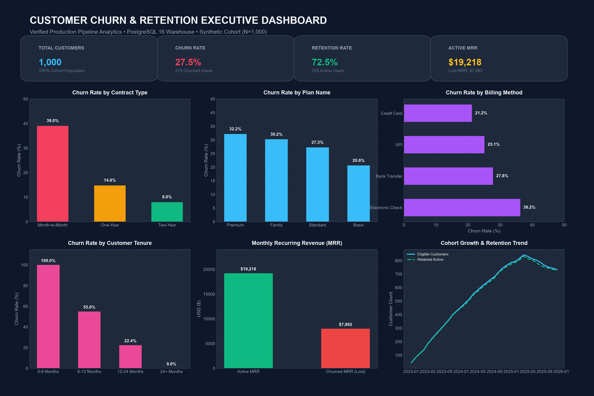
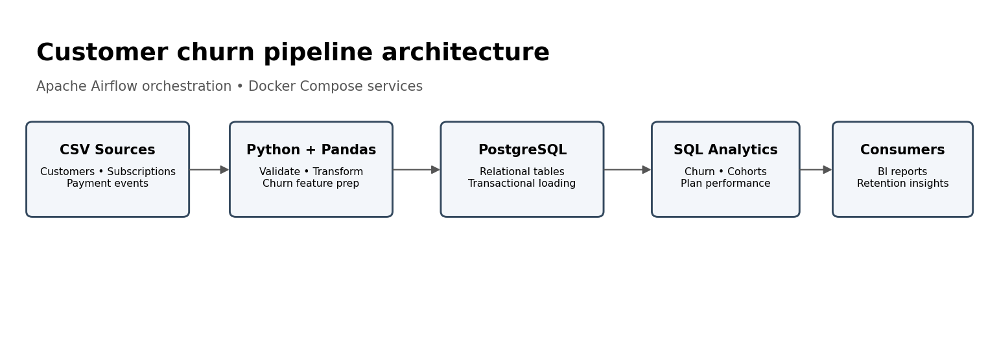
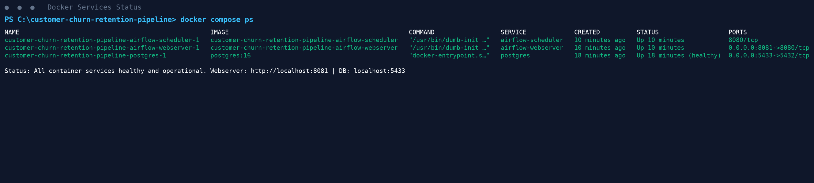
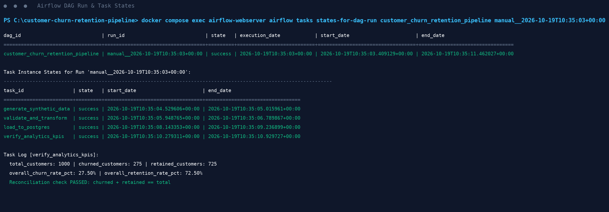
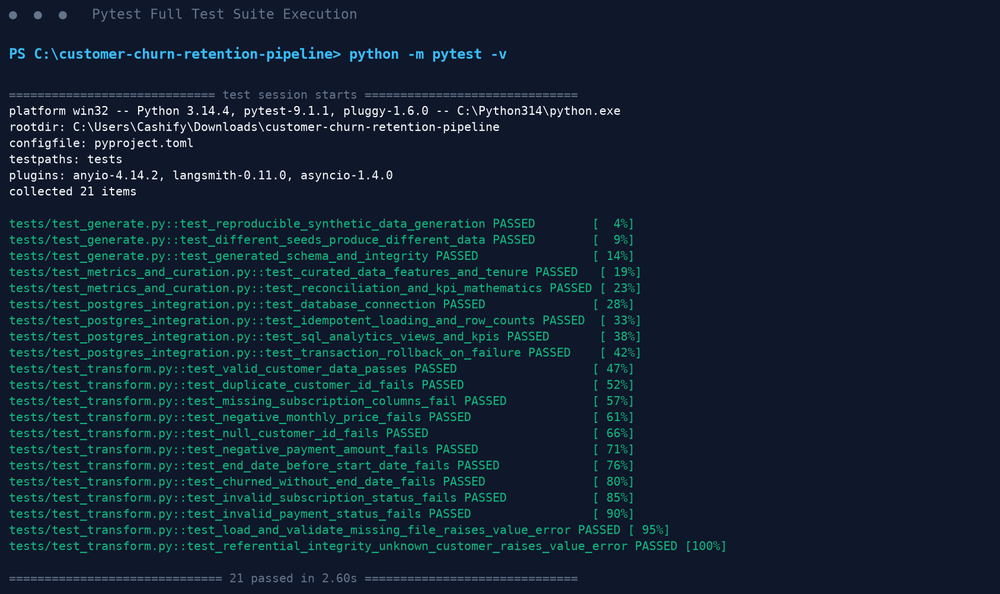
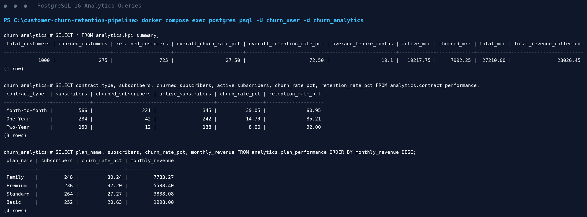

# Customer Churn & Retention Analytics Pipeline

A production-grade, end-to-end data engineering portfolio project that synthesizes subscription lifecycle data, validates and transforms records with Python & Pandas, loads relational and curated tables transactionally into PostgreSQL 16, publishes automated analytical views for churn and retention KPIs, and orchestrates the complete workflow using Apache Airflow in Docker Compose.

---

## 🌐 Live Interactive Demo (Resume Showcase)

> **🚀 Live Clickable Demo URL:** [https://temporary-rushing-ochre-hsdpxgk.vercel.app](https://temporary-rushing-ochre-hsdpxgk.vercel.app)  
> **Claim Link (to keep permanently on your Vercel account):** [https://vercel.com/claim-deployment?code=db8389e6-78ea-4bb4-b90d-f1ceda371aae](https://vercel.com/claim-deployment?code=db8389e6-78ea-4bb4-b90d-f1ceda371aae)  
> **GitHub Pages URL (after pushing):** `https://YOUR_GITHUB_USERNAME.github.io/customer-churn-retention-pipeline/`

An interactive, responsive executive analytics demo featuring:
- **Interactive KPI Dashboard:** Real-time dynamic filtering across Contract Types, Subscription Plans, Payment Channels, and Marketing Funnels.
- **Customer Data Explorer:** Filterable, searchable table across all 1,000 curated customer lifecycle records with pagination.
- **SQL Analytics Studio:** Interactive query workbench with pre-loaded queries and instant result rendering from PostgreSQL warehouse views.
- **Airflow DAG Visualizer:** Visual walkthrough of the 4-task pipeline with verified execution logs and runtime benchmarks.

### Launch Live Demo Locally (One Command):
```powershell
python -m churn_pipeline.cli demo
```
*Opens automatically in your default browser at `http://localhost:8501/docs/index.html`.*

### Enable Public Live Demo on GitHub (For Resume Links):
1. In your GitHub repository, navigate to **Settings** > **Pages**.
2. Under **Build and deployment** > **Branch**: Select `main` and folder `/ (root)` or `/docs`.
3. Click **Save**. Your live URL is instantly active and ready to attach directly to your resume!

---

## Executive Dashboard & Visual Proof

### 1. Verified Analytics Dashboard


### 2. Pipeline Architecture


### 3. Docker Services Running


### 4. Airflow Orchestration & Task Execution


### 5. Passing Test Suite (21 Tests)


### 6. PostgreSQL Warehouse Analytics Queries


---

## Business Problem & Project Objectives

In recurring revenue and subscription businesses (SaaS, telecom, digital media), customer churn is the single most critical factor constraining lifetime value and growth. Understanding when and why customers cancel enables proactive retention strategies, targeted pricing interventions, and contract optimization.

### Project Goals:
1. **Automate Data Ingestion & Quality:** Validate schemas, nulls, duplicates, and referential integrity before database ingestion.
2. **Standardize Churn & Retention Metrics:** Replace ambiguous metrics with mathematically rigorous cohort and period calculations.
3. **Idempotent Relational Loading:** Ensure repeat pipeline runs produce deterministic, duplicate-free tables in PostgreSQL.
4. **Publish Curated Datasets:** Export feature-rich customer data with pre-calculated tenure and segmentation for BI tools (Power BI, Excel).
5. **Robust Orchestration:** Automate extraction, validation, loading, and KPI audit verification using Apache Airflow.

---

## Technology Stack

- **Data Processing:** Python 3.11+, Pandas 2.1+
- **Relational Warehouse:** PostgreSQL 16
- **Database Access:** SQLAlchemy, Psycopg2-binary
- **Workflow Orchestration:** Apache Airflow 2.10.4
- **Containerization:** Docker Desktop, Docker Compose v2+
- **Testing & QA:** pytest 8+ (21 unit & integration tests)
- **Analytics & BI:** PostgreSQL Views, Power BI / Excel (`data/curated/curated_customer_retention.csv`)

---

## Repository Structure

```text
customer-churn-retention-pipeline/
├── airflow/
│   └── dags/
│       └── customer_churn_retention_pipeline.py  # Airflow 4-task DAG definition
├── data/
│   ├── raw/                                      # Generated synthetic CSVs (git-ignored)
│   └── curated/                                  # Curated features & audit reports
│       ├── curated_customer_retention.csv
│       ├── data_quality_report.json
│       └── data_quality_report.md
├── docs/
│   ├── architecture.md                           # System architecture notes
│   └── power_bi_dashboard_guide.md               # Power BI connection & DAX formulas
├── screenshots/                                  # High-resolution runtime captures
├── scripts/
│   └── capture_evidence.py                       # Automated screenshot generator
├── sql/
│   └── analytics_queries.sql                     # Production warehouse analytical queries
├── src/
│   └── churn_pipeline/
│       ├── __init__.py
│       ├── cli.py                                # CLI entry point (generate, run, report)
│       ├── config.py                             # DB connection with auto host-port routing
│       ├── dashboard.py                          # Executive dashboard visualization generator
│       ├── generate.py                           # Reproducible synthetic data synthesizer
│       ├── load.py                               # Table DDL, transactional loader, and views
│       └── transform.py                          # Data validation, cleaning, and curation
├── tests/
│   ├── test_generate.py                          # Seeding and data integrity tests
│   ├── test_metrics_and_curation.py              # Math, tenure, and reconciliation tests
│   ├── test_postgres_integration.py              # DB connection, idempotency, rollback tests
│   └── test_transform.py                         # Validation rules and error handling tests
├── .env.example                                  # Template environment configuration
├── .gitignore                                    # Excludes .env, caches, logs, and datasets
├── docker-compose.yml                            # PostgreSQL & Airflow multi-container stack
├── Dockerfile                                    # Airflow image with compatible dependencies
├── pyproject.toml                                # Package metadata & pytest configuration
├── README.md                                     # Project documentation
└── requirements.txt                              # Python package dependencies
```

---

## Data Dictionary

### 1. `customers.csv` (Raw Ingestion)
- `customer_id` (Integer, Primary Key): Unique customer identifier.
- `customer_name` (Text): Synthetic customer name.
- `city` (Text): Customer location (Pune, Mumbai, Delhi, Bengaluru, etc.).
- `signup_date` (Date): Account creation date.
- `acquisition_channel` (Text): Marketing channel (`organic`, `paid_search`, `referral`, `social`, `email`).

### 2. `subscriptions.csv` (Raw Ingestion)
- `subscription_id` (Integer, Primary Key): Unique subscription identifier.
- `customer_id` (Integer, Foreign Key): References `customers.customer_id`.
- `plan_name` (Text): Plan tier (`Basic`, `Standard`, `Premium`, `Family`).
- `contract_type` (Text): Billing commitment (`Month-to-Month`, `One-Year`, `Two-Year`).
- `payment_method` (Text): Payment channel (`Credit Card`, `Bank Transfer`, `UPI`, `Electronic Check`).
- `monthly_price` (Numeric): Plan fee in USD ($9.99 to $44.99).
- `start_date` (Date): Subscription start date.
- `end_date` (Date, Nullable): Cancellation date (Null for active users).
- `subscription_status` (Text): Account status (`active`, `churned`).

### 3. `payment_events.csv` (Raw Ingestion)
- `payment_event_id` (Integer, Primary Key): Event identifier.
- `subscription_id` (Integer, Foreign Key): References `subscriptions.subscription_id`.
- `event_date` (Date): Transaction date.
- `payment_status` (Text): Transaction outcome (`paid`, `failed`, `refunded`).
- `amount` (Numeric): Payment value in USD.

### 4. `curated_customer_retention.csv` (Curated Analytical Dataset)
- Contains all customer and subscription attributes plus:
  - `tenure_days` (Integer): Total days active or until churn.
  - `tenure_months` (Numeric): Duration active in months (`tenure_days / 30.4375`).
  - `tenure_group` (Text): Lifecycle cohort (`0-6 Months`, `6-12 Months`, `12-24 Months`, `24+ Months`).
  - `is_churned` (Integer): Binary indicator (1 if churned, 0 if active).
  - `is_retained` (Integer): Binary indicator (1 if active, 0 if churned).
  - `monthly_recurring_revenue` (Numeric): Active recurring revenue (0 if churned).
  - `total_revenue` (Numeric): Total sum of successful paid transactions.

---

## Churn & Retention Metric Definitions

1. **Overall Churn Rate (%):**
   $$\text{Churn Rate} = \frac{\text{Total Churned Customers in Cohort}}{\text{Total Eligible Customers in Cohort}} \times 100$$
2. **Overall Retention Rate (%):**
   $$\text{Retention Rate} = \frac{\text{Total Active Customers in Cohort}}{\text{Total Eligible Customers in Cohort}} \times 100$$
   *Note: Churn Rate + Retention Rate = 100.0%.*
3. **Monthly Churn Rate (%):**
   Evaluates subscribers who canceled in month $M$ divided by subscribers eligible entering month $M$ ($\text{active at start} + \text{new signups}$).
4. **Monthly Recurring Revenue (MRR):**
   - **Active MRR:** Sum of `monthly_price` for accounts where `subscription_status = 'active'`.
   - **Lost MRR:** Sum of `monthly_price` for accounts where `subscription_status = 'churned'`.

---

## Quick Start (Windows PowerShell)

### Prerequisites
- Python 3.11+
- Docker Desktop with Docker Compose enabled
- Git

### 1. Environment Setup
Clone the repository and set up environment variables:

```powershell
# Copy environment configuration
Copy-Item .env.example .env

# Install Python package locally in editable mode (optional for host execution)
pip install -e .
```

### 2. Start Docker Services
Start PostgreSQL 16 and the Apache Airflow stack:

```powershell
docker compose up -d
docker compose ps
```

- **PostgreSQL Database:** accessible on `localhost:5433` (external port to prevent port conflicts with any local PostgreSQL instance on 5432).
- **Airflow Web UI:** accessible on `http://localhost:8081` (Default login: `admin` / `admin`).

### 3. Generate Synthetic Data
Generate 1,000 reproducible customer records (`seed=77`):

```powershell
# Via Docker:
docker compose exec airflow-webserver python -m churn_pipeline.cli generate --output-dir /opt/airflow/project/data/raw --customers 1000

# Or directly on Windows host:
python -m churn_pipeline.cli generate --output-dir data/raw --customers 1000
```

### 4. Run the ETL Pipeline
Validate, clean, engineer tenure features, and load into PostgreSQL transactionally:

```powershell
# Via Docker:
docker compose exec airflow-webserver python -m churn_pipeline.cli run --input-dir /opt/airflow/project/data/raw

# Or directly on Windows host:
python -m churn_pipeline.cli run --input-dir data/raw
```

### 5. Inspect the Data Quality Audit Report
Print the verified quality audit and KPI reconciliation report:

```powershell
python -m churn_pipeline.cli report
```

### 6. Run the Test Suite (21 Tests)
Execute all unit, data-integrity, and PostgreSQL integration tests:

```powershell
# Via Docker:
docker compose exec airflow-webserver pytest -v

# Or on Windows host:
python -m pytest -v
```

---

## Orchestrating with Apache Airflow

The pipeline includes a 4-step Directed Acyclic Graph (`customer_churn_retention_pipeline`):

```text
[generate_synthetic_data] ──> [validate_and_transform] ──> [load_to_postgres] ──> [verify_analytics_kpis]
```

1. Open your browser at **http://localhost:8081**.
2. Log in with `admin` / `admin`.
3. Locate DAG `customer_churn_retention_pipeline`.
4. Trigger the DAG manually from the UI or via CLI:

```powershell
docker compose exec airflow-webserver airflow dags trigger customer_churn_retention_pipeline
```

5. Monitor execution and inspect task status:

```powershell
docker compose exec airflow-webserver airflow tasks states-for-dag-run customer_churn_retention_pipeline <run_id>
```

---

## PostgreSQL Analytics Queries

Connect to PostgreSQL via CLI or database tool (DBeaver, pgAdmin, DataGrip):

- **Host:** `localhost`
- **Port:** `5433` (container port `5432` mapped to host `5433`)
- **Database:** `churn_analytics`
- **Username:** `churn_user`
- **Password:** `change_me_local_only`

```powershell
# Interactive psql session
docker compose exec postgres psql -U churn_user -d churn_analytics
```

### Example 1: Executive KPI Overview
```sql
SELECT * FROM analytics.kpi_summary;
```
**Result:**
```text
 total_customers | churned_customers | retained_customers | overall_churn_rate_pct | overall_retention_rate_pct | average_tenure_months | active_mrr | churned_mrr | total_mrr | total_revenue_collected
-----------------+-------------------+--------------------+------------------------+----------------------------+-----------------------+------------+-------------+-----------+-------------------------
            1000 |               275 |                725 |                  27.50 |                      72.50 |                  19.1 |   19217.75 |     7992.25 |  27210.00 |                23026.45
```

### Example 2: Churn by Contract Commitment
```sql
SELECT contract_type, subscribers, churned_subscribers, active_subscribers, churn_rate_pct, retention_rate_pct, monthly_revenue
FROM analytics.contract_performance
ORDER BY churn_rate_pct DESC;
```
**Result:**
```text
 contract_type  | subscribers | churned_subscribers | active_subscribers | churn_rate_pct | retention_rate_pct | monthly_revenue
----------------+-------------+---------------------+--------------------+----------------+--------------------+-----------------
 Month-to-Month |         566 |                 221 |                345 |          39.05 |              60.95 |         9406.55
 One-Year       |         284 |                  42 |                242 |          14.79 |              85.21 |         6287.58
 Two-Year       |         150 |                  12 |                138 |           8.00 |              92.00 |         3523.62
```

### Example 3: Churn by Customer Tenure Cohort
```sql
SELECT tenure_group, subscribers, churned_subscribers, active_subscribers, churn_rate_pct, avg_tenure_months, mrr_lost_to_churn, active_mrr
FROM analytics.tenure_cohorts
ORDER BY churn_rate_pct DESC;
```
**Result:**
```text
 tenure_group | subscribers | churned_subscribers | active_subscribers | churn_rate_pct | avg_tenure_months | mrr_lost_to_churn | active_mrr
--------------+-------------+---------------------+--------------------+----------------+-------------------+-------------------+------------
 0-6 Months   |          91 |                  91 |                  0 |         100.00 |               3.5 |           2619.09 |       0.00
 6-12 Months  |         171 |                  94 |                 77 |          54.97 |               9.3 |           2689.06 |    2179.23
 12-24 Months |         402 |                  90 |                312 |          22.39 |              17.6 |           2684.10 |    8171.88
 24+ Months   |         336 |                   0 |                336 |           0.00 |              30.0 |                   |    8866.64
```

---

## Power BI & Excel Dashboard

1. Follow the comprehensive setup guide in [`docs/power_bi_dashboard_guide.md`](docs/power_bi_dashboard_guide.md).
2. Connect directly to `localhost:5433` (PostgreSQL) or import `data/curated/curated_customer_retention.csv`.
3. Pre-built DAX measures, star schema relationships, and chart layout blueprints are provided in the guide.
4. To regenerate the executive dashboard graphic from the live database at any time:

```powershell
python -m churn_pipeline.dashboard
```

---

## Troubleshooting & FAQ

| Issue | Cause | Solution |
| :--- | :--- | :--- |
| **Port 5432 conflict** | Another PostgreSQL container or local service is running on 5432. | This project maps PostgreSQL to host port `5433:5432`. Ensure `POSTGRES_EXTERNAL_PORT=5433` in `.env`. Host commands automatically route to 5433. |
| **Port 8080 conflict** | Another web server is using 8080. | This project maps Airflow Webserver to `8081:8080`. Access Airflow at `http://localhost:8081`. |
| **Airflow ORM Error** | Incompatible SQLAlchemy version (`2.0+`). | Airflow 2.10 requires `SQLAlchemy<2.0`. Ensure `requirements.txt` pins `SQLAlchemy>=1.4.36,<2.0.0`. |
| **Missing Input File Error** | `data/raw/*.csv` has not been generated yet. | Run `python -m churn_pipeline.cli generate --customers 1000` before running the ETL. |

---

## Stopping the Services

To shut down containers cleanly while preserving PostgreSQL data volumes:

```powershell
docker compose down
```

To remove containers and wipe database volumes:

```powershell
docker compose down -v
```

---

## Disclaimer & Limitations

- **Synthetic Data Notice:** All customer records, demographics, subscription plans, and transaction amounts generated by this pipeline are synthetic and created for educational, pipeline demonstration, and portfolio purposes. They do not represent real individuals, businesses, or actual customer behavior.
